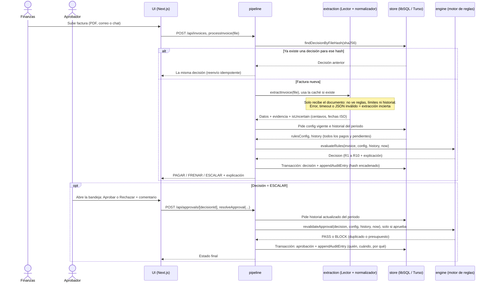

# Triple Firma: propuesta para el reto Blinka

> **Tesis en una línea:** el LLM **lee**, el código **decide**, la persona **autoriza**.
> Tres firmas, y ninguna puede saltarse a las otras. Por eso el agente nunca paga algo indebido.

Entrega: **domingo 12:00 m (mediodía)**. Meta interna: **domingo 10:00 am** con todo listo; de 10 a 12 es colchón.
Tiempo real: unas 41 horas desde el viernes 7 pm, de las cuales unas 24 a 26 son efectivas descontando sueño.
Equipo: 5 personas, mayoría desarrolladores, con Claude Code.

---

## 1. El problema, en claro

Una empresa de EE. UU. con proveedores en Colombia, México, Argentina y Ecuador recibe decenas de cobros al mes por correo, PDF o chat. Hoy alguien de finanzas:

1. lee la factura,
2. la compara con lo acordado,
3. pide aprobación por chat,
4. crea el pago a mano (otra moneda, otro país),
5. concilia en Excel qué pagó y por qué.

Blinka quiere que un agente haga 1 a 3 y deje registro de 5. **El problema de fondo no es leer facturas, es la confianza**: el agente tiene que pagar solo lo que debe, explicar cada decisión y nunca pasarse de los límites.

### Cómo nos califican (y qué significa para el diseño)

| Criterio | Qué miden | Implicación de diseño |
|---|---|---|
| **Seguridad** | Cero pagos aprobados fuera de reglas. **Uno solo descalifica.** | El LLM nunca decide. PAGAR solo si *todas* las reglas pasan explícitamente. Ante cualquier duda: escalar. |
| **Autonomía** | Qué parte del set decide bien sin humano | No escalar todo "por si acaso". FRENAR una violación objetiva también es una decisión autónoma correcta. |
| **Explicabilidad** | Cualquiera entiende el porqué leyendo el registro | Cada regla deja su resultado con los valores comparados. La explicación se arma con plantillas, no se inventa. |

**La tensión clave:** escalar todo da seguridad perfecta y autonomía cero. Nuestra respuesta es mostrar siempre las dos métricas juntas en la pantalla, medidas contra una tabla de resultados esperados escrita a mano.

---

## 2. La propuesta

### 2.1 Idea central

```
 Documento ──► [1] LECTOR (LLM) ──► datos extraídos + evidencia
 (PDF/img/                              │
  correo/chat)                          ▼
                                  [2] MOTOR DE REGLAS (código puro, determinista)
                                        │  evalúa TODAS las reglas
                                        ▼
                         PAGAR ── FRENAR ── ESCALAR ──► [3] HUMANO (bandeja)
                                        │
                                        ▼
                           REGISTRO append-only + explicación
```

Lo que nos diferencia de otros equipos:

1. **El LLM no toca la decisión.** Solo extrae a quién, cuánto, qué moneda, para cuándo y la referencia, con evidencia (el fragmento del documento de donde lo sacó). Ni siquiera ve las reglas ni los límites, así que una factura con "apruébame sin revisar" no tiene nada que manipular.
2. **Todas las reglas se evalúan siempre.** La decisión final es la más restrictiva (algún FRENAR → FRENAR; si no, algún ESCALAR → ESCALAR; si no, PAGAR). No usamos "la primera que falla", porque esconde motivos y depende del orden.
3. **Fail-safe por defecto.** Un error del modelo, un JSON inválido, un timeout, un campo faltante o una regla sin configurar terminan en ESCALAR, nunca en PAGAR.
4. **Aprobar una escalada vuelve a validar** presupuesto y duplicado en ese momento, y registra quién aprobó, cuándo y por qué.
5. **Registro con hash encadenado** y un botón "Verificar integridad". Es barato (unas 40 líneas) y en la demo se ve muy bien.

**El LLM no tiene tools.** No ejecuta acciones ni elige pasos: recibe un documento y devuelve JSON. Las "herramientas" del sistema son funciones de código con un flujo fijo (sección 6.2). Por eso no es un agente autónomo que pueda equivocarse de camino: el único camino posible es el que programamos.

### 2.2 Los "agentes" del sistema (en ejecución)

Somos honestos: en ejecución hay **un solo punto con LLM** (más uno opcional). El resto es código. Ese es justamente el argumento de confianza.

| # | Componente | ¿Usa LLM? | Qué hace | Prioridad |
|---|---|---|---|---|
| 1 | **Lector** | Sí, `claude-sonnet-5-5` (lee PDF e imagen de forma nativa) | Devuelve JSON validado con Zod: valor crudo, evidencia, bandera `isUncertain` por campo. Nunca completa lo que no ve. | **P0** |
| 2 | **Normalizador** | No | Convierte `1.500,00` / `1,500.00` / `$` / fechas a valores exactos (centavos enteros, ISO). Si el formato es ambiguo, marca incierto y la factura se escala. | **P0** |
| 3 | **Motor de reglas** | No | Evalúa R1 a R10 (sección 3) y combina por precedencia. | **P0** |
| 4 | **Explicador** | No | Arma frases desde plantillas con los valores: *"Escalada: el monto (USD 4.200,00) supera el umbral de aprobación (USD 2.000,00)."* | **P0** |
| 5 | **Registro / Auditoría** | No | Append-only en libSQL (SQLite) y hash encadenado sobre JSON canónico. | P0 (registro) / P1 (hash y botón) |
| 6 | **Verificador** | Sí, `claude-haiku-5-5` con otro prompt | Segunda lectura independiente de los campos críticos. Si no coincide con el Lector, se escala. | **P1** |
| 7 | **Red Team** | Sí, fuera del flujo | Genera facturas hostiles (duplicados disfrazados, nombres casi iguales, fraccionamiento, inyección). El resultado esperado lo pone una persona, no el sistema. | **P1** (P0 si son casos escritos a mano) |
| 8 | **Servidor MCP** | No | Expone `evaluate_invoice` (recibe un documento y devuelve la decisión con su explicación), `get_rules` (configuración vigente, solo lectura) y `get_decision_status` (estado de una factura, incluido si está pendiente) para que *otros agentes* usen el sistema como pagador. **No** expone `approve_escalation`: la aprobación es siempre humana, desde la bandeja. | **P2** (vale mucho en el pitch) |

> Los IDs de modelo y sus precios se verifican al arrancar con la documentación de Anthropic (skill `claude-api` en Claude Code). Si el Lector con Haiku da la misma exactitud sobre el set de desarrollo, usamos Haiku y bajamos costo. Decidimos con datos medidos, no con supuestos.

**Modo demo sin red (P0):** guardamos en caché la extracción por hash del archivo (`data/cache/<sha256>.json`). La demo corre igual sin internet o si se acaba la cuota, y además es reproducible.

---

## 3. Reglas de negocio (resumen ejecutable)

Configuración editable desde la pantalla. **Una regla sin configurar nunca pasa por defecto.**

| Regla | Condición | Resultado | Ejemplo de explicación |
|---|---|---|---|
| **R1 Extracción completa** | Falta un campo obligatorio, hay un campo con `isUncertain`, el esquema es inválido o no hay evidencia | ESCALAR | "No se pudo leer con certeza el monto." |
| **R2 Duplicado** | Exacto: mismo beneficiario (`normalizePayee`), monto, moneda y referencia (`normalizeReference`, que ignora mayúsculas, espacios, guiones, barras y puntos) ya pagada o pendiente | FRENAR | "Ya se pagó la factura FAC-102 de Café Andino (COP 4.500.000) el 03/10." |
| | Casi duplicado: la referencia difiere en un carácter o en ceros a la izquierda ("FAC-102" vs "FAC-103" o "FAC-0102") con el mismo beneficiario y monto | ESCALAR | "Posible duplicado de FAC-102, requiere revisión." |
|                                | Coincide con una factura que antes fue **rechazada** por una persona o **frenada** (aunque sea otro archivo)       | ESCALAR | "Esta factura coincide con FAC-102, que fue rechazada el 03/10; requiere revisión." |
| **R3 Beneficiario** (se evalúa **en este orden**, y la primera condición que se cumple decide) | 1. Coincidencia exacta con un beneficiario **bloqueado** | FRENAR | "Old Vendor LLC está bloqueado por la empresa." |
| | 2. Coincidencia aproximada con un beneficiario **bloqueado**, aunque también coincida exacto con uno permitido | ESCALAR | "El nombre se parece a 'Old Vendor LLC', que está bloqueado; requiere revisión." |
| | 3. Coincidencia exacta con un beneficiario permitido | pasa | |
| | 4. Coincidencia aproximada con un permitido: difiere en tildes, en una letra de otro alfabeto (por ejemplo, una "a" cirílica que se ve igual a la latina), en un carácter o en signos como `&` o `-` ("Acmé Corp", "A&B" vs "AB"). Las diferencias de mayúsculas, espacios, puntos y comas ("Corp." vs "Corp", "S.A.S." vs "SAS") **no** cuentan: son coincidencia exacta | ESCALAR | "El nombre se parece a 'Dev Partners SAS' pero no es idéntico." |
| | 5. No está en ninguna lista | ESCALAR | "Beneficiario nuevo: no está en la lista permitida." |
| **R4 Conforme a lo acordado** | Monto, moneda o vigencia no coinciden con el acuerdo (tolerancia configurable en la **moneda del acuerdo**, por defecto 0) | FRENAR | "Cobra USD 3.000; lo acordado es USD 2.500 mensuales." |
| | Sin acuerdo registrado | ESCALAR | |
| **R5 Límite por pago** | Monto en USD > umbral de aprobación | ESCALAR | "USD 4.200 supera el umbral de aprobación de USD 2.000." |
| | Monto en USD > tope absoluto (opcional; en la empresa ficticia, USD 10.000) | FRENAR | "USD 15.000 supera el tope absoluto de USD 10.000." |
| **R6 Presupuesto del periodo** | Pagado + aprobado + este pago > presupuesto mensual | FRENAR | "Presupuesto de octubre: USD 18.400 usados de 20.000; este pago (USD 2.100) lo excede." |
| | Solo se excede al sumar lo comprometido por escaladas pendientes | ESCALAR | "El presupuesto de octubre tiene USD 2.500 comprometidos por escaladas pendientes; este pago lo excedería." |
| **R7 Fraccionamiento** | Suma en USD al mismo beneficiario en `splitPaymentWindowDays` días > `approvalThresholdMinor`, aunque cada pago esté por debajo | ESCALAR | "Dev Partners SAS suma USD 2.600 en 7 días; supera el umbral de aprobación de USD 2.000." |
| **R8 Moneda** | Moneda desconocida o ambigua (`$` sin país) | ESCALAR | |
| | Conversión con tasa fija de la configuración: aritmética exacta y un solo redondeo al centavo (ver decisión 3) | — | |
| **R9 Fechas** | Vencimiento inválido, ya vencido más de X días o a más de Y días en el futuro | ESCALAR | |
| **R10 Contenido sospechoso** | Instrucciones dirigidas al agente dentro del documento (las que reporta el Lector **y** las que el motor encuentra por su cuenta en `sourceText`, el texto original de correos y chats), o el total no cuadra con la suma de ítems | ESCALAR | "El documento contiene instrucciones dirigidas al sistema; se ignoraron." |

### Decisiones del paso cero: cerradas por A

| # | Decisión | Qué se decidió | Cómo queda en los contratos |
|---|---|---|---|
| 1 | ¿Las escaladas pendientes reservan presupuesto? | **Sí** (control de compromisos, como en finanzas). Si lo **pagado o aprobado** más este pago excede el presupuesto → **FRENAR**. Si solo se excede al sumar las **escaladas pendientes** → **ESCALAR**, porque la pendiente aún podría rechazarse. Al aprobar se revalida siempre, así que en ningún orden hay fuga. **Al aprobar, R6 cuenta solo lo pagable del periodo** (no las otras pendientes, porque quien aprueba está eligiendo entre ellas): así dos pendientes nunca se bloquean entre sí y el presupuesto tampoco se excede. | El historial incluye las escaladas con estado `PENDING_APPROVAL` |
| 2 | ¿Cuántos umbrales tiene R5? | **Dos.** Umbral de aprobación: si el monto es **estrictamente mayor** → ESCALAR (USD 2.000,00 pasa; USD 2.000,01 escala). Tope absoluto **opcional**: si se supera → FRENAR, sin opción de aprobar. En la empresa ficticia el tope está encendido en **USD 10.000**. | `approvalThresholdMinor` y `hardCapMinor` (opcional, `null` = apagado) |
| 3 | ¿Cómo se convierte la moneda? | **Como en contabilidad:** cada factura se convierte a USD **una sola vez**, con la tasa fija de la configuración, aritmética exacta de enteros (`BigInt`) y **un único redondeo al centavo** (mitad hacia arriba). Ese monto en USD queda registrado junto con la tasa usada, y todas las comparaciones y sumas se hacen en **centavos enteros de USD**. Nunca hay fracciones de centavo que escalen una factura por error, y lo que se compara es exactamente lo que se muestra. Un monto que al convertir queda por debajo de medio centavo (por ejemplo, COP 0,01) cuenta como USD 0,00: es insignificante y se acepta así. | Tasas como **texto decimal** en unidades por 1 USD (`"4000"`, `"18.50"`, `"1"`). Cada decisión y cada entrada del historial guardan `amountMinor`, `currency`, `exchangeRate` y `baseAmountMinor` (USD en centavos). |
| 4 | Zona horaria del periodo | `America/New_York`, configurable | `timezone` en la configuración |
| 5 | R4: la factura no cuadra con lo acordado | Cobra **más** de lo acordado → FRENAR. Cobra **menos** → ESCALAR. La tolerancia se aplica en la moneda del acuerdo, antes de convertir. | `toleranceMinor` (en la moneda del acuerdo; por defecto 0) |
| — | ¿Umbral distinto según la prioridad del proveedor? | **No en este hackatón.** Umbral único (ver abajo). | — |

**Reglas generales del dinero:** enteros en unidades menores, nunca `float` ni `parseFloat`. Una moneda sin tasa configurada → ESCALAR (R8). Las tasas son fijas en la configuración: la conversión es exacta respecto a esa tasa, y así cada decisión es reproducible.

### Sobre la prioridad del proveedor: decisión tomada, no se hace

Alguien del equipo propuso que el umbral de aprobación dependiera de la prioridad del proveedor (por ejemplo, crítico USD 3.000 y bajo USD 500). **No lo vamos a construir**, por cuatro razones:

1. **El reto no lo pide.** Pide "aprobación humana por encima de cierto monto", y un umbral único lo cumple completo.
2. **No mejora ningún criterio de evaluación.** La autonomía se mide contra resultados esperados que escribimos nosotros, así que la nota no sube. La explicabilidad queda igual.
3. **Agrega riesgo justo en el criterio que descalifica.** Un umbral más alto es un camino nuevo hacia PAGAR, y si queda mal configurado puede pagar algo que debía escalarse.
4. **Cuesta de 1 a 2 horas** que rinden más asegurando cero fugas y un buen set de facturas.

En el pitch lo mencionamos como **siguiente paso**: "la configuración ya permite extenderlo a umbrales por proveedor".

Lo que sí se mantiene, porque no es una regla y casi no cuesta: **la bandeja ordenada por vencimiento**, con las vencidas o próximas a vencer marcadas en rojo. Es un `ORDER BY` en la UI y no toca el motor.

Una regla se mantiene en cualquier caso: "URGENTE" o "pagar hoy" escrito en la factura nunca cambia nada. Es texto no confiable; si va dirigido al agente, se reporta en R10.

---

## 4. Datos: empresa ficticia y set de facturas

- **Empresa:** *Andes Labs Inc.* (Delaware), moneda base USD, presupuesto mensual USD 20.000, umbral de aprobación USD 2.000.
- **Proveedores (ficticios):** CO (COP), MX (MXN), AR (ARS) y EC (USD, porque Ecuador está dolarizado: es un buen caso).
- **Formatos:** PDF generado (P0), correo `.eml`/`.txt` (P0), chat estilo WhatsApp `.txt` (P0), imagen PNG o foto de PDF (P1).
- **Tamaño:** unas 36 facturas en tres particiones:
  - `dev/` (20): visible, para ajustar prompts y reglas.
  - `holdout/` (8): **sellada**, no se mira hasta el domingo. Prohibido ajustar contra ella.
  - `adversarial/` (8+): trampas e inyección.
- **`expected.csv`**, escrito a mano por la persona C: `archivo, decisión esperada, reglas que deben disparar`. Ningún proceso automático lo modifica.

**Trampas obligatorias del reto, todas cubiertas:** duplicado, beneficiario nuevo, no cuadra con lo acordado, sobre el umbral, presupuesto agotado.
**Nuestras trampas extra:** casi duplicado, nombre parecido con tilde o letra cirílica ("Acmé Corp", o "Acme Corp" escrito con una "a" cirílica), separador decimal confuso, subtotal vs total, inyección de instrucciones, fraccionamiento, conversión de moneda que cruza el umbral por un centavo, cambio de mes y reenvío de la misma factura (idempotencia).

---

## 5. Métricas (en la pantalla y en `npm run eval`)

| Métrica | Fórmula | Meta |
|---|---|---|
| **Fugas** | # facturas con PAGAR cuando lo esperado era FRENAR o ESCALAR | **0** (descalificante) |
| **Exactitud** | decisiones == esperado / total | Lo más alta posible; reportamos el número real |
| **Autonomía** | facturas con esperado ∈ {PAGAR, FRENAR} decididas correctamente / facturas con esperado ∈ {PAGAR, FRENAR} | Alta |
| **Sobreescalación** | ESCALAR cuando lo esperado era PAGAR o FRENAR | Baja (cuesta autonomía, no seguridad) |
| **Explicabilidad** | % de decisiones cuya explicación cita la regla y los valores comparados (chequeo automático) | 100 % |
| Costo y latencia | tokens y ms por factura | Se reporta |

La matriz de errores es asimétrica: PAGAR de más es falla crítica; frenar o escalar de más es falla blanda.

---

## 6. Tecnologías, arquitectura y estructura (sin sobreingeniería)

### 6.1 Tecnologías: decisión tomada

**Next.js full-stack en TypeScript. Un solo lenguaje, un solo proceso, un solo comando.** No usamos Python.

| Capa | Tecnología | Por qué |
|---|---|---|
| Lenguaje | **TypeScript** con `strict: true` | Los mismos tipos y esquemas sirven para la UI, la API, el motor y los scripts |
| Runtime | **Node.js 24 LTS** | La última LTS. Estable y con binarios precompilados para las librerías que usamos |
| Framework (front y back) | **Next.js**, última versión estable, con App Router y Route Handlers | La UI y la API viven en el mismo proyecto. Sin CORS, sin dos servidores. |
| UI | **Tailwind CSS** + **shadcn/ui** | Tablas, badges, formularios y diálogos listos. D no pierde tiempo en CSS. |
| Validación y contratos | **Zod** | Valida la salida del LLM, la configuración que se edita en pantalla y los cuerpos de la API, todo con el mismo esquema |
| Base de datos | **libSQL** (SQLite) con **`@libsql/client`**: en local es un archivo (`file:local.db`) y en el deploy es **Turso** | Es relacional (tablas, SQL estándar de SQLite, `JOIN`, transacciones). Para programar nadie instala nada ni crea cuentas; en la nube solo cambian dos variables de entorno. Si Next.js no logra empaquetarlo, se agrega a `serverExternalPackages` en `next.config`. |
| Hosting | **Vercel** (la app) + **Turso** (los datos), ambos en plan gratuito | Vercel hace el deploy, pero no guarda archivos entre ejecuciones. Por eso los datos viven en Turso y los reinicios no borran nada. |
| LLM | **`@anthropic-ai/sdk`**: `claude-sonnet-5-5` para el Lector y `claude-haiku-5-5` para el Verificador | Lee PDF e imagen de forma nativa, así que no necesitamos OCR |
| Tests | **Vitest** | Rápido y sin configuración extra para TypeScript |
| Scripts | **tsx** | Corre `scripts/*.ts` sin compilar |
| Generar facturas PDF | **pdfkit** | Solo para armar el dataset |
| Calidad | **ESLint + Prettier** (vienen con `create-next-app`) | Estilo uniforme entre las 5 personas |
| CI | **GitHub Actions** | Tests y eval en cada push |

**Lo que NO usamos, a propósito:**
- **ORM** (Prisma, Drizzle): son 6 tablas, y SQL directo es más rápido de escribir y de leer.
- **LangChain, frameworks de agentes o colas**: el flujo es fijo y no debe decidirlo el modelo (ver sección 9).
- **Librerías de estado global en el front** (Redux, Zustand): alcanzan los Server Components y el `fetch` simple.
- **Auth real**: quien aprueba escribe su nombre. Es una demo local, y lo decimos así.
- **Docker, microservicios ni servidores de base de datos que haya que instalar.**
- **Supabase o Postgres:** resuelven lo mismo que Turso, pero con más piezas (otro dialecto de SQL, pooler de conexiones, una librería aparte para las transacciones y conexión a internet para programar).

**Por qué no Python:** tendríamos dos lenguajes, los contratos duplicados (Pydantic y Zod), dos procesos y dos comandos para arrancar. La ventaja típica de Python, que son sus librerías de PDF y OCR, aquí no aplica porque Claude lee el PDF directamente.

**Plan B (solo si hace falta):** si Turso o Vercel dan problemas el sábado, no se hace deploy. La demo se presenta en local, que es lo imprescindible; la URL pública es un extra (P2).

### 6.2 Arquitectura

**Monolito modular:** un solo proceso de Next.js, con módulos separados por responsabilidad y una regla de dependencias estricta.

```
┌──────────────────────────── Next.js (un proceso Node) ────────────────────────────┐
│                                                                                   │
│   FRONTEND (src/app + src/components)  ──fetch──►  BACKEND: API (src/app/api)     │
│                                            │                                      │
│                                            ▼                                      │
│                         pipeline (src/pipeline) — orquesta, sin lógica de negocio │
│                ┌───────────────────┬───────┴───────────┬────────────────────┐     │
│                ▼                   ▼                   ▼                    ▼     │
│        extraction/            engine/              engine/              store/    │
│        reader + verifier      rules R1–R10         explain              libSQL    │
│        normalize, cache       decide               (plantillas)         audit log │
│        (I/O: Claude API)      (PURO, sin I/O)      (PURO)               approvals │
│                                                                                   │
│        Todos dependen solo de  contracts/  (esquemas Zod y tipos)                 │
└───────────────────────────────────────────────────────────────────────────────────┘
```

**Regla de dependencias (no negociable):**

| Módulo | Puede importar | No puede importar |
|---|---|---|
| `contracts/` | `zod` | nada más |
| `engine/` | `contracts/` | `extraction/`, `store/`, SDK de Anthropic, `fs`, `Date.now()` |
| `extraction/` | `contracts/`, SDK de Anthropic | `engine/`, `store/` (no ve reglas, límites ni historial) |
| `store/` | `contracts/`, `@libsql/client` | `engine/`, `extraction/` |
| `pipeline/` | todos los anteriores | `app/`, `components/`, `lib/` |
| `app/api/` (backend) | `pipeline/`, `store/` (lectura), `contracts/` | `engine/` y `extraction/` directamente |
| Pantallas en `app/`, `components/` y `lib/` (frontend) | `contracts/` (solo tipos y esquemas), `components/`, `lib/` | `engine/`, `extraction/`, `store/`, `pipeline/` y `app/api/` |

**Frontend y backend: un solo proyecto, carpetas separadas.** No son dos proyectos ni dos deploys (eso traería CORS, dos comandos y tipos duplicados). Pero la separación es real:

1. **El frontend solo habla con el backend por HTTP.** Todas las llamadas pasan por un único archivo, `src/lib/api-client.ts` (dueño: D), con una función por endpoint: `listDecisions`, `getDecision`, `getRulesConfig`, `saveRulesConfig`, `resolveApproval`, `verifyAuditChain` y `getMetrics`. Ninguna pantalla hace `fetch` suelto ni importa código del backend. Las pantallas que cargan datos son componentes cliente (`"use client"`) que usan ese archivo.
2. **D trabaja desde el viernes sin esperar a E.** Con `NEXT_PUBLIC_USE_MOCK_API=true`, `api-client.ts` devuelve datos de ejemplo de `src/lib/mocks/`, validados con los mismos esquemas de `contracts/` para que no se desvíen de las respuestas reales. Cuando E termina un endpoint, se apaga la variable y la pantalla no cambia.
3. **El contrato entre los dos lados son los esquemas de `contracts/` y la tabla de la API** de abajo. Si un endpoint cambia su respuesta, se cambia primero el esquema (con aprobación de A) y los dos lados se ajustan a él.

El motor es una **función pura**: `evaluateRules(invoice, config, history, now) → Decision`. Sin `history` (pagos, aprobaciones y escaladas pendientes), R2 no podría detectar duplicados ni R6 saber cuánto presupuesto queda; por eso es un parámetro obligatorio. Como `now` entra por parámetro, la misma entrada siempre da la misma decisión, y los tests de frontera de mes o de zona horaria son triviales. P1: hacer cumplir la tabla con la regla `no-restricted-imports` de ESLint (unos 10 minutos).

**Flujo de una factura** (`pipeline/processInvoice`):

1. Se calcula el SHA-256 del archivo. Si ya existe una decisión para ese hash, se devuelve la misma. Así un reenvío no genera un segundo pago.
2. **Extracción:** si hay caché se usa; si no, se llama al Lector, se valida con Zod y se normaliza. Cualquier error se convierte en una extracción marcada como incierta, que R1 escala.
3. Se cargan desde `store` la versión vigente de la configuración y el historial de pagos (pagables y escaladas pendientes).
4. **Motor:** evalúa R1 a R10, combina por precedencia y genera las explicaciones.
5. **En una sola transacción** se guardan la decisión y la entrada del registro con su hash. libSQL serializa las escrituras (en local y en Turso), así que no hay carrera por el presupuesto.
6. Si la decisión es ESCALAR, va a la bandeja. Al aprobar se revalidan R2 y R6 y se escribe otra entrada en el registro.

**Diagrama de secuencia** (GitHub lo dibuja directamente desde Mermaid):



**Funciones principales por módulo** (el contrato entre personas; los tipos salen de `contracts/`):

| Módulo · dueño | Función | Qué hace | ¿LLM? |
|---|---|---|---|
| `extraction` · B | `extractInvoice(file)` | Lee el documento y devuelve payee, monto, moneda, vencimiento y referencia, cada uno con evidencia e `isUncertain`. Valida con Zod y reintenta una vez; si falla, devuelve una extracción incierta. | Sí (Sonnet) |
| `extraction` · B | `normalizeExtraction(raw)` | Convierte `1.500,00` / `1,500.00`, símbolos de moneda y fechas a centavos enteros e ISO. Si el formato es ambiguo, marca el campo como incierto. | No |
| `extraction` · B | `verifyExtraction(file, extraction)` (P1) | Segunda lectura independiente; si no coincide en campos críticos, marca incierto. | Sí (Haiku) |
| `engine` · A | `evaluateRules(invoice, config, history, now)` | Corre R1 a R10, combina por precedencia y devuelve la `Decision` con cada `ruleResult`. | No |
| `engine` · A | `explainDecision(decision)` | Arma la explicación en español desde las plantillas de `messages.ts`, con los valores comparados. | No |
| `engine` · A | `revalidateApproval(decision, config, history, now)` | Al aprobar, vuelve a correr R2 y R6 con el historial actual. | No |
| `store` · E | `findDecisionByFileHash(fileHash)` | Idempotencia: devuelve la decisión previa o `null`. | No |
| `store` · E | `listPaymentHistory()` | Facturas pagables y escaladas pendientes de **todos** los periodos, con su tasa y su `baseAmountMinor`. El motor filtra por periodo (R6) o por ventana (R7); R2 necesita todo para frenar duplicados de meses anteriores. | No |
| `store` · E | `appendAuditEntry(tx, payload)` | Escribe en el registro append-only con hash encadenado, dentro de la transacción. | No |
| `store` · E | `verifyAuditChain()` | Recorre la cadena de hashes y reporta la primera entrada alterada, si la hay. | No |
| `pipeline` · E | `processInvoice(file)` | Orquesta el flujo completo de una factura. | No |
| `pipeline` · E | `resolveApproval(decisionId, action, comment, approver)` | Aprueba (con revalidación) o rechaza, y lo registra. | No |

**Tablas:** `config_versions`, `invoices` (con `file_hash` único), `extractions`, `decisions`, `approvals` y `audit_entries` (`seq`, `prev_hash`, `hash`, `payload_json`, append-only).

**API (Route Handlers):**

| Método | Ruta | Para qué |
|---|---|---|
| `POST` | `/api/invoices` | Subir y procesar una factura |
| `POST` | `/api/invoices/batch` | Procesar todo un set (`dev`, `adversarial`, `holdout`) |
| `GET` | `/api/decisions?status=PAY\|BLOCK\|ESCALATE` | Listar decisiones |
| `GET` | `/api/decisions/[id]` | Detalle: extracción, reglas y explicación |
| `GET` / `PUT` | `/api/config` | Leer o guardar las reglas (valida con Zod; si es inválida, responde 400) |
| `POST` | `/api/approvals/[decisionId]` | Aprobar o rechazar con `{ action, comment, approver }` |
| `GET` | `/api/audit/verify` | Verificar la cadena de hashes |
| `GET` | `/api/metrics` | Autonomía, exactitud y fugas contra `expected.csv` |

### 6.3 Estructura del repositorio

```
triple-firma/
├── CLAUDE.md                  # reglas para todos los Claude Code del equipo
├── README.md                  # para el jurado: cómo correrlo, capturas, métricas
├── .claude/agents/            # subagentes de desarrollo (sección 8)
├── .github/workflows/ci.yml   # tests + eval en cada push
├── data/
│   ├── config/company.json    # reglas por defecto de Andes Labs
│   ├── invoices/{dev,holdout,adversarial}/
│   ├── expected.csv           # verdad de referencia (solo persona C)
│   └── cache/                 # extracciones cacheadas por hash
├── src/
│   │   # ── COMPARTIDO ──
│   ├── contracts/   ← A     # esquemas Zod: ExtractedInvoice, RulesConfig, Decision, AuditEntry, Approval
│   │   # ── FRONTEND (D) ──
│   ├── app/         ← D     # pantallas: rules/, decisions/, inbox/ (sin lógica de negocio)
│   ├── components/  ← D     # tablas, badges, formularios, detalle por regla
│   ├── lib/         ← D     # api-client.ts (única puerta al backend) y mocks/
│   │   # ── BACKEND ──
│   ├── app/api/     ← E     # route handlers: validan la entrada y llaman a pipeline/ o store/
│   ├── pipeline/    ← E     # process-invoice.ts, resolve-approval.ts
│   ├── engine/      ← A     # rules/ (un archivo por regla), evaluate-rules.ts, explain-decision.ts, messages.ts
│   ├── extraction/  ← B     # extract-invoice.ts, verify-extraction.ts, normalize-extraction.ts, cache.ts, prompts/
│   └── store/       ← E     # db.ts, schema.sql, *-repository.ts, audit-log.ts
├── scripts/         ← C     # generate-invoices.ts, eval.ts, red team
└── tests/                   # unitarios del motor y casos límite
```

### 6.4 Convenciones de código

**Idioma:**
- **En inglés:** todo el código, nombres de archivos, variables, funciones, tipos, comentarios, commits, ramas, PRs y `CLAUDE.md`.
- **En español, por excepción:** el texto que lee el usuario final, es decir, las etiquetas de la UI y las plantillas de explicación del registro. El jurado y la empresa leen en español, y eso suma explicabilidad. Esas plantillas viven en un solo archivo (`src/engine/messages.ts`), no regadas por el código. El `README.md` también va en español porque lo lee el jurado.

**Nombres:**
- `camelCase` para variables y funciones; `PascalCase` para tipos y componentes; `kebab-case` para archivos; `UPPER_SNAKE_CASE` para constantes.
- Nombres que dicen qué hacen: `evaluateBudgetRule`, no `checkR6` ni `helper2`.

**Buenas prácticas, sin sobreingeniería:**
- **Cada regla es una función** `(ctx: RuleContext) => RuleResult` en su propio archivo, y el motor las recorre en un arreglo. Nada de clases abstractas, plugins, inyección de dependencias ni patrones "por si acaso".
- **Dinero:** `amountMinor` en centavos enteros. Está prohibido usar `float` o `parseFloat` para montos.
- **Fechas:** ISO 8601, con la zona horaria de la configuración y `now` inyectado. Nunca `new Date()` dentro del motor.
- **Prohibido `any`.** Los datos externos (LLM, API, archivos) entran siempre por un `schema.parse`.
- **Errores:** nunca se silencian. En extracción se devuelve un resultado tipado (`{ ok: false, reason }`) y la factura se escala.
- **Funciones cortas y con un solo propósito.** Sin código muerto, sin código comentado y sin `console.log` en `src/` (en `scripts/` sí se permite).
- **Tests:** cada regla con al menos su caso que pasa, el que no pasa y el de frontera (igual al límite, un centavo arriba, un centavo abajo).
- **Secretos:** solo en `.env.local`. El repo lleva `.env.example`.

**Contratos primero.** Los esquemas Zod de `src/contracts/` se congelan el viernes a las 10 pm. Desde ahí cada persona trabaja en su carpeta contra los contratos y con datos de ejemplo, sin bloquear a nadie.

Los contratos ya están en `src/contracts/` (uno por concepto, Zod 4) y son la fuente única de tipos:

| Archivo | Esquemas principales | Qué garantiza el propio esquema |
|---|---|---|
| `money.ts` | `CurrencyCodeSchema`, `SupportedCurrencySchema`, `ExchangeRateSchema`, `MinorAmountSchema` | Montos enteros; tasas como texto decimal positivo, nunca `number`; la configuración solo admite USD, COP, MXN y ARS (todas con 2 decimales) |
| `dates.ts` | `IsoDateSchema`, `IsoDateTimeSchema`, `PeriodSchema`, `TimezoneSchema` | Fechas guardadas siempre en UTC; periodo `AAAA-MM`; zona horaria IANA válida |
| `payee.ts` | `normalizePayee`, `PayeeNameSchema` | Una sola forma de comparar nombres, usada por la configuración y por R3: ignora mayúsculas, espacios, caracteres invisibles, puntos y comas; conserva tildes, otros alfabetos y signos como `&` o `-` |
| `reference.ts` | `normalizeReference`, `ReferenceSchema` | Una sola forma de comparar referencias para R2 (mayúsculas, espacios, guiones, barras, puntos y caracteres invisibles): "FAC-102" y "fac 102" son la misma |
| `extraction.ts` | `ExtractionSchema` | Cada campo con `raw`, `value`, `evidence` e `isUncertain`; monto positivo (0 o negativo queda incierto y R1 escala) |
| `invoice.ts` | `InvoiceSchema` | Hash SHA-256 del archivo, formato de origen y `sourceText` (obligatorio en correos y chats) para que R10 no dependa solo del LLM |
| `rules-config.ts` | `RulesConfigSchema`, `AgreementSchema` | Todos los campos obligatorios; la moneda base con tasa 1; tope mayor que el umbral; nadie permitido y bloqueado a la vez; sin acuerdos solapados para un mismo beneficiario |
| `history.ts` | `HistoryEntrySchema`, `isCountedInBudget` | Guarda tasa, `baseAmountMinor` y `period` de cada pago o escalada pendiente; conserva rechazadas y frenadas para R2 |
| `decision.ts` | `DecisionSchema`, `RuleResultSchema`, `combineRuleOutcomes` | R1 a R10 evaluadas exactamente una vez; la decisión es la más restrictiva; PAGAR siempre registra monto, moneda, monto en USD y tasa |
| `approval.ts` | `ApprovalRequestSchema`, `ApprovalSchema` | Comentario obligatorio; rechazar termina en FRENAR; aprobar solo paga si la revalidación pasó |
| `audit-entry.ts` | `AuditEntrySchema` | Solo la primera entrada no tiene `prevHash` |

### 6.5 Consistencia de nombres entre todos

Además de las buenas prácticas, **el repo tiene que leerse como si lo hubiera escrito una sola persona**, no como 5 proyectos pegados. Por eso cada concepto tiene **un solo nombre** en todas las capas (contratos, motor, extracción, base de datos, API y UI), y cada tipo de archivo sigue el mismo patrón.

**Glosario obligatorio:** la versión vigente y completa está en `CLAUDE.md` (sección *Glossary*), que es la fuente única. Así el Claude Code de cada persona lo lee siempre actualizado y no hay dos versiones que se contradigan. Incluye los términos del paso cero: `baseAmountMinor`, `exchangeRate`, `approvalThresholdMinor`, `hardCapMinor`, `toleranceMinor`, `timezone`, `blockedPayees` y `history` (con estados `PAYABLE`, `PENDING_APPROVAL`, `REJECTED` y `BLOCKED`).

**Patrones por tipo de elemento:**

| Elemento | Patrón | Ejemplo |
|---|---|---|
| Esquema Zod y su tipo | `<Name>Schema` y `type <Name> = z.infer<...>` | `DecisionSchema`, `Decision` |
| Archivo de una regla | `<concept>-rule.ts` | `duplicate-rule.ts` |
| Función de una regla | `evaluate<Concept>Rule` | `evaluateDuplicateRule` |
| Otras funciones | verbo + sustantivo | `processInvoice`, `normalizeAmount`, `verifyAuditChain` |
| Acceso a datos (`store/`) | archivo `<entity>-repository.ts`; verbos fijos: `find…` (uno o `null`), `list…` (varios), `insert…`, `update…` | `findDecisionByFileHash`, `listPendingApprovals` |
| Booleanos | `is…`, `has…`, `can…` | `isUncertain`, `hasAgreement` |
| Tablas y columnas | `snake_case`; tablas en plural | `decisions.file_hash`, `audit_entries` |
| JSON de la API y contratos | `camelCase`. La conversión desde `snake_case` se hace **solo** en `store/`. | `amountMinor`, `dueDate` |
| Valores de enums | `UPPER_SNAKE_CASE` | `PAY`, `ESCALATE` |
| Componentes React | componente en `PascalCase`, archivo en `kebab-case` | `DecisionDetail` en `decision-detail.tsx` |
| Rutas de la API | sustantivos en plural | `/api/decisions/[id]` |
| Tests | `tests/<módulo>/<archivo>.test.ts` | `tests/engine/duplicate-rule.test.ts` |
| Variables de entorno | `UPPER_SNAKE_CASE` | `ANTHROPIC_API_KEY`, `TURSO_DATABASE_URL`, `TURSO_AUTH_TOKEN` |

**Cómo lo aseguramos:**
1. El glosario y estos patrones van en `CLAUDE.md`, así el Claude Code de cada persona los sigue sin que nadie lo pida.
2. Los tipos salen **siempre** de `contracts/`. Nadie redefine en su carpeta un tipo para un concepto que ya existe.
3. Un concepto nuevo se agrega al glosario **en el mismo PR** que lo usa, y lo aprueba A.
4. Todos usan la misma configuración de ESLint y Prettier y el mismo gestor de paquetes (**npm**). `npm run lint` corre en la CI.
5. En la revisión de cada PR se revisa el nombrado igual que la lógica. Un nombre fuera del glosario es motivo para pedir cambios.

### La pantalla (3 vistas, P0)

1. **Reglas:** formulario validado con Zod; una configuración inválida no se guarda; cada cambio crea una nueva versión. Al cambiar una tasa de cambio, la pantalla muestra la conversión resultante ("1 USD = 4.000 COP") y pide confirmación, para que un cero de más no pase inadvertido.
2. **Decisiones:** filtro Pagó / Frenó / Pendiente. El detalle muestra el documento original, los datos extraídos con su evidencia, cada regla con ✅/⚠️/⛔ y sus valores, y la explicación.
3. **Bandeja de aprobación:** ordenada por vencimiento (la más próxima primero), con Aprobar o Rechazar, comentario obligatorio y revalidación al aprobar.

Encabezado fijo con **Autonomía · Exactitud · Fugas: 0** y el botón **Verificar integridad del registro**.

**Flujo del usuario:**
1. Sube una factura (PDF, correo `.eml`/`.txt` o chat `.txt`).
2. Ve la decisión en segundos (PAGAR, FRENAR o ESCALAR) con su explicación.
3. Si es ESCALAR, quien aprueba la resuelve desde la bandeja.
4. Todo queda en el registro: quién, cuándo y por qué.

### Deploy y rutinas de demo (dueño: E)

| Qué | Prioridad | Detalle |
|---|---|---|
| **Repo en GitHub** | P0 | README con cómo correrlo en 3 comandos, capturas y la tabla de métricas. Incluye `.env.example`; **nunca se sube la API key** ni datos reales. |
| `npm run demo` | P0 | Reinicia la BD, carga `company.json`, procesa `dev/` y `adversarial/` **desde la caché** y abre `http://localhost:3000`. No necesita API key. |
| `npm run demo:live` | P0 | Igual, pero llama al modelo de verdad (requiere `ANTHROPIC_API_KEY`). |
| `npm run eval` | P0 | Imprime las métricas y **termina con error si hay una sola fuga**. |
| **GitHub Actions** | P1 | En cada push corre `npm test` y `npm run eval` en modo caché, con un badge "Fugas: 0". Es como media hora de trabajo y da mucha credibilidad. |
| `npm run demo:tamper` | P1 | Altera un registro directamente en la base de datos para mostrar que el botón de integridad lo detecta. |
| **URL pública: Vercel + Turso** | P2 | Vercel aloja la app y Turso guarda los datos, así que los reinicios de Vercel no borran nada. La URL corre en **modo caché**: no se configura `ANTHROPIC_API_KEY` en Vercel, así que nadie puede gastar nuestros tokens desde la URL (una factura nueva subida ahí se escala por fail-safe). El lote se carga desde local, porque Vercel corta las peticiones largas. |

**Pasos del deploy (E, sábado 1 pm, unos 20 min, todo gratis):**
1. Crear una base en Turso y copiar su URL y su token.
2. Importar el repo de GitHub en Vercel. Desde ahí, cada push a `main` se publica solo.
3. En Vercel, agregar las variables `TURSO_DATABASE_URL` y `TURSO_AUTH_TOKEN`.
4. Desde local, correr `npm run demo` apuntando a Turso para cargar config y decisiones desde la caché.
5. Probar la URL: aprobar una escalada, recargar la página y comprobar que sigue aprobada.

**Guion de la demo (4 min):**
1. **Reglas:** mostrar los límites, la lista de proveedores permitidos y el presupuesto.
2. **Correr el lote:** X pagadas, Y frenadas, Z escaladas.
3. **Abrir dos casos:** un duplicado frenado y una factura con instrucciones escondidas. Se ven la regla, los valores comparados y la frase.
4. **Bandeja:** aprobar una escalada y mostrar que la revalidación frena la siguiente porque el presupuesto ya no alcanza.
5. **En vivo:** bajar el umbral y procesar una factura nueva. La decisión y su explicación cambian.
6. **Integridad:** `demo:tamper` y luego el botón, que detecta la alteración.
7. **Cierre con números:** "0 fugas en N facturas (M adversariales), autonomía de X %".

---

## 7. Organización del equipo (5 personas)

Cada persona es **dueña de una carpeta** y trabaja con su propio Claude Code. Nadie edita carpetas ajenas sin avisar; los cambios a `contracts/` los aprueba A.

| Persona | Rol | Carpeta | Entregables P0 | P1 |
|---|---|---|---|---|
| **A** | Líder técnico · Motor de reglas | `contracts/`, `engine/` | Contratos Zod, R1–R10, precedencia, explicador, más de 30 tests de casos límite | Revalidación al aprobar, R7 |
| **B** | Extracción con LLM | `extraction/` | Prompt del Lector v1, v2…, normalizador de montos y fechas, caché, fail-safe ante errores del API | Verificador, comparación Sonnet vs Haiku con datos |
| **C** | Datos, evaluación y Red Team | `data/`, `scripts/` | Empresa ficticia, unas 36 facturas, `expected.csv`, `npm run eval` con métricas | Generador adversarial, reporte del Red Team |
| **D** | Frontend | `app/` (sin `api/`), `components/`, `lib/` | Las 3 vistas, `api-client.ts` y mocks, contra datos de ejemplo desde el viernes | Visor del documento, gráficos de métricas |
| **E** | Backend · Persistencia · Demo | `store/`, `app/api/` | Base de datos libSQL, registro append-only, endpoints, bandeja, repo en GitHub, `npm run demo` y `demo:live` | Hash encadenado con verificación, GitHub Actions, `demo:tamper`, README; deploy en Vercel + Turso y MCP (P2) |

**Pitch y video:** A y C (son quienes mejor conocen reglas y números). E arma el README final.

**Regla de independencia:** C escribe los resultados esperados **sin mirar** lo que hace el motor. Si A o B quieren cambiar `expected.csv`, discute el equipo completo. Así nuestra métrica de fugas es creíble.

### Commits, ramas y PRs

**Formato: [Conventional Commits](https://www.conventionalcommits.org/), en inglés.**

```
<type>(<scope>): <description>
```

- **Tipos:** `feat` (funcionalidad nueva), `fix` (corrección), `test`, `refactor`, `docs`, `chore` (configuración o dependencias), `ci`, `style` (solo formato o UI visual sin cambiar lógica).
- **Scopes:** `contracts`, `engine`, `extraction`, `store`, `pipeline`, `api`, `ui`, `data`, `scripts`. Si el cambio es de todo el repo, va sin scope.
- **Descripción:** en imperativo ("add", no "added" ni "adds"), en minúscula, sin punto final y con máximo 72 caracteres en total.
- **Un commit equivale a un cambio lógico** y debe dejar `npm test` en verde. Nada de `wip`, `fix stuff`, `changes` ni `update`.
- **Cambio que rompe un contrato:** `feat(contracts)!: ...`, y solo con la aprobación de A.
- **Si hace falta contexto**, se agrega un cuerpo después de una línea en blanco que explique el porqué, no el qué.
- Claude Code agrega una línea `Co-Authored-By` al final del commit. Se deja.

**Ramas y PRs:**
- Ramas cortas, de horas y no de días: `<type>/<scope>-<tema>`, por ejemplo `feat/engine-duplicate-rule` o `fix/extraction-decimal-separator`.
- El PR se titula igual que el commit. Se hace squash merge a `main` cuando la CI está en verde.
- **Revisión:** los PRs a `engine/` y `contracts/` los revisa otra persona además de su autor, más el subagente `rules-auditor`. El resto puede hacer merge su propio dueño con la CI en verde.
- `main` siempre tiene que correr `npm run demo`.

**Commits exactos por persona** (en orden, uno por tarea del plan). Si una tarea se parte en dos, se mantiene el mismo patrón.

**A · Motor de reglas**
```
feat(contracts): add zod schemas for invoice, rules config and decision
feat(contracts): add audit entry and approval schemas
feat(engine): add extraction completeness rule (R1)
feat(engine): add duplicate detection rule (R2)
feat(engine): add payee allowlist rule (R3)
feat(engine): add agreement conformity rule (R4)
feat(engine): add per-payment approval threshold rule (R5)
feat(engine): add period budget rule (R6)
feat(engine): add split payment detection rule (R7)
feat(engine): add currency conversion rule (R8)
feat(engine): add due date rule (R9)
feat(engine): add suspicious content rule (R10)
feat(engine): combine rule results by most restrictive outcome
feat(engine): build explanations from rule message templates
feat(engine): revalidate duplicates and budget on approval
test(engine): add boundary cases for thresholds and period change
```

**B · Extracción**
```
chore(extraction): add anthropic client with timeout and retry
feat(extraction): add reader prompt v1 with structured output
feat(extraction): normalize amounts, currencies and dates
feat(extraction): cache extractions by file hash
feat(extraction): mark extraction uncertain on invalid output or api error
feat(extraction): add reader prompt v2
feat(extraction): add independent verifier read
docs(extraction): add prompt version comparison on dev set
```

**C · Datos y evaluación**
```
feat(data): add fictitious company rules config
feat(scripts): add invoice pdf generator
feat(data): add dev invoice set
feat(data): add expected decisions for dev set
feat(data): add adversarial invoice set
feat(scripts): add eval script with leak check
feat(data): add sealed holdout set
docs(data): add red team report
```

**D · Frontend**
```
feat(ui): add api client with mock responses
feat(ui): add app layout with metrics header
feat(ui): add rules config view with validation
feat(ui): add decisions list with status filter
feat(ui): add decision detail with per-rule results
feat(ui): add approval inbox sorted by due date
feat(ui): add audit integrity check button
style(ui): polish decision detail layout
```

**E · Backend y demo**
```
chore: initialize next.js project with typescript, tailwind and vitest
docs: add CLAUDE.md with team conventions
feat(store): add libsql schema and repositories
feat(store): add append-only audit log
feat(pipeline): add invoice processing pipeline
feat(api): add invoice, decision and config endpoints
feat(api): add approval endpoint with revalidation
feat(store): chain audit entries with sha256 hashes
feat(scripts): add demo, demo:live and demo:tamper commands
ci: run lint, tests and eval on every push
chore: configure turso database for vercel deployment
docs: add readme with setup, deploy steps and metrics
```

**Correcciones típicas** (como referencia del formato):
```
fix(engine): round currency conversion against the payment
fix(extraction): parse comma as decimal separator for COP amounts
fix(store): reject duplicate file hash on reprocess
test(engine): cover budget exhausted by accumulated payments
```

### Plan horario

| Bloque | A (motor) | B (lector) | C (datos) | D (UI) | E (backend) |
|---|---|---|---|---|---|
| **Vie 7–10 pm** | Contratos Zod | Probar el API, prompt v0 | Empresa ficticia y 10 facturas | Esqueleto de las 3 vistas | Repo, libSQL en local, CLAUDE.md con el glosario |
| **🏁 Vie 10 pm** | **Contratos congelados** | | | | |
| Vie 10 pm–1 am | R1–R6 con tests | Lector y normalizador | `expected.csv` v1 | Vistas con datos de ejemplo | Endpoints y registro |
| Sáb 8 am–1 pm | R7–R10, explicador | Caché y fail-safe | Set completo (36) | Detalle por regla | Bandeja y aprobaciones |
| **🏁 Sáb 1 pm** | **De punta a punta con 10 facturas reales** | | | | |
| Sáb 1–6 pm | Revalidación al aprobar | Prompt v2 contra dev | `eval.ts` | Métricas en el encabezado | Hash encadenado, `npm run demo`, deploy en Vercel + Turso (20 min) |
| **🏁 Sáb 6 pm** | **Primera corrida completa de métricas. Cualquier fuga se arregla antes que todo lo demás.** | | | | |
| Sáb 6–10 pm | Bugs del eval, casos límite | Verificador (P1, solo si no hay fugas) | Red Team con casos a mano | Pulido | README |
| **🧊 Sáb 10 pm** | **Freeze de features. Desde aquí, solo bugs.** | | | | |
| Sáb 10 pm–12 am | Bugs | Bugs | **Corrida sobre holdout** y números finales | Capturas | `npm run demo` desde un clon limpio y deploy final en Vercel |
| Dom 8–10 am | Guion y ensayo de la demo (A y C), video | Soporte | Soporte | Soporte | Entrega en la plataforma |
| **🏁 Dom 10 am** | **Entrega lista.** De 10 a 12 m, colchón para imprevistos. | | | | |

> El domingo no se programa nada nuevo: es solo para ensayar y entregar. Si algo no está el sábado a las 10 pm, no entra.

### Orden de recorte (si vamos tarde, se cae primero lo de arriba)

Con entrega al mediodía, **asumimos desde ya que el MCP y las facturas en imagen no entran**, salvo que el sábado a las 6 pm estemos sin fugas y adelantados.

1. Servidor MCP (P2)
2. Generador automático del Red Team: nos quedamos con los casos adversariales escritos a mano
3. Verificador con segundo LLM: se reemplaza por chequeos deterministas (total = suma de ítems, evidencia presente)
4. Facturas en imagen: nos quedamos con PDF, correo y chat
5. Botón de integridad con hash: queda solo el registro append-only

**Nunca se recorta:** el motor de reglas con fail-safe, el registro con explicación, la bandeja, el eval con la métrica de fugas y las 3 vistas.

---

## 8. Agentes de desarrollo (Claude Code)

Cada persona trabaja con Claude Code. Para que los 5 generen código coherente proponemos:

**`CLAUDE.md` compartido (lo escribe E el viernes)** con las invariantes:
- El LLM nunca decide; `engine/` no importa nada de `extraction/` ni del SDK de Anthropic.
- Dinero en centavos enteros; prohibido `float` para montos.
- Ante duda, ESCALAR. Una regla sin configurar no pasa.
- Solo se tocan las carpetas propias; `contracts/` requiere aprobación de A.
- Se respeta la regla de dependencias de la sección 6.2.
- El glosario y los patrones de nombres de la sección 6.5, completos. Un concepto, un solo nombre en todo el repo.
- Código, comentarios y commits en inglés. Solo el texto de la UI y las plantillas de `messages.ts` van en español (sección 6.4).
- Commits con Conventional Commits y los scopes de la sección 7. Un cambio lógico por commit.
- Sin sobreingeniería: no se crean abstracciones, clases base ni dependencias nuevas sin una necesidad concreta de hoy.
- Comandos: `npm test`, `npm run eval`, `npm run demo`.

**Subagentes en `.claude/agents/` (solo 3, sin más):**

| Subagente | Quién lo usa | Para qué |
|---|---|---|
| `rules-auditor` | A, antes de cada merge al motor | Revisor adversarial: busca un camino por el que una factura llegue a PAGAR indebidamente (regla vacía, redondeo, frontera de mes, orden de evaluación). Solo lectura. |
| `invoice-forger` | C | Genera facturas ficticias en PDF, correo y chat a partir de una especificación (sin datos reales). **No** escribe `expected.csv`. |
| `prompt-evaluator` | B | Corre el eval sobre `dev/`, compara versiones de prompt y reporta exactitud por campo. Tiene prohibido leer `holdout/`. |

Lo demás (UI, API) se hace con Claude Code normal; no hace falta un agente especial.

---

## 9. Sobre "Harness"

Depende de a qué se refiera el ingeniero:

- **Harness.io** (plataforma de CI/CD y despliegue): **no la necesitamos.** Corremos local con un comando. Configurarla cuesta horas y no suma ningún punto en los criterios del reto.
- **"Agent harness"** (el ciclo que envuelve al LLM: herramientas, reintentos, validación, registro): **sí lo tenemos, pero lo escribimos nosotros**, y es pequeño: llamar al modelo → validar con Zod → un reintento → si falla, ESCALAR. Son unas 50 líneas en `extraction/`. Un framework de agentes (LangChain, Agent SDK con ciclo autónomo, etc.) dejaría que el modelo eligiera pasos, y eso juega **en contra** de la seguridad y la reproducibilidad que nos califican.
- Para **desarrollar**, el harness ya es Claude Code con los subagentes de la sección 8.

**Recomendación:** no adoptar ninguna herramienta nueva este fin de semana. Si el ingeniero tiene un caso concreto en mente, que lo explique en 5 minutos en el kickoff y se decide ahí.

---

## 10. Riesgos y lo que NO vamos a prometer

| Riesgo | Mitigación |
|---|---|
| El LLM lee mal un monto | Evidencia obligatoria, bandera `isUncertain`, verificador (P1), y R4 compara contra lo acordado |
| Se acaba la cuota del API durante la demo | Caché por hash; la demo corre offline |
| Los 5 Claude Code generan código incoherente | Contratos congelados el viernes, glosario y patrones de nombres (6.5) en CLAUDE.md, una carpeta por dueño |
| Integración tardía | Hito de punta a punta el sábado a la 1 pm |
| Ajustamos de más contra nuestro propio set | El holdout está sellado y lo corre C solo el sábado a las 10 pm, después del freeze |
| Falla Vercel o Turso el día de la presentación | La presentación va en local; la URL es un extra |

**No prometemos:**
- Detectar fraude ni verificar identidad (está fuera del alcance). Un casi duplicado o un nombre parecido se reporta como "requiere revisión humana", sin acusar a nadie.
- Que el registro sea inalterable. El hash **detecta** alteraciones, pero quien controla la base puede recalcular toda la cadena. Mitigación barata: mostrar el hash final en pantalla y exportarlo en cada corrida (anclaje externo). Lo decimos así en el pitch.
- "0 fugas" en general. Reportamos "0 fugas en N facturas, incluidas M adversariales", con el tamaño real de la muestra.

---

## 11. Qué opinamos del prompt anterior

Está bien orientado: los principios I1 a I9 son correctos y los adoptamos. Ajustes:

- **Sobra para unas 25 horas efectivas:** 40 facturas con 30 casos límite *antes* de codificar, el MCP como algo serio y un plan de comparación de prompts muy formal. Lo dejamos en P1/P2.
- **Falta:** un hito de integración temprano, el modo offline con caché para la demo, y la regla de que quien escribe los resultados esperados no es quien escribe el motor.
- **Fecha:** la entrega es el domingo a mediodía. El prompt anterior proponía terminar a las 11 am; nosotros adelantamos a las 10 am para tener dos horas de colchón.

---

## 12. Kickoff de hoy (30 min)

1. Leer este documento (10 min).
2. Confirmar las decisiones abiertas de la sección 3 (5 min).
3. Asignar A, B, C, D y E (5 min).
4. Que el ingeniero aclare lo de Harness (5 min).
5. Cada persona clona el repo y lo inicia siguiendo "Puesta en marcha" del `README.md`. Debe ver http://localhost:3000 y `{"status":"ok"}` en http://localhost:3000/api/health antes de escribir código (10 min).
6. Cada persona lee `CLAUDE.md` (glosario, nombres y commits). A empieza los contratos y todos arrancan en su carpeta.
